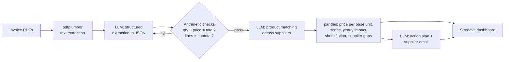

# 🛡️ MarginGuard

**Catch the supplier price rises that quietly eat a small restaurant's profit.**

MarginGuard reads a café or restaurant's supplier invoices, tracks the real price of every ingredient over time, and flags increases the owner never noticed — including *shrinkflation* (same price, smaller pack). It tells them what each increase costs per year and drafts the email to push back.

**Track:** AI + Business — ForgeHacks 2026

| | |
|---|---|
| 🎥 Demo video | _add YouTube link_ |
| 🌐 Live app | _add Streamlit link_ |


---

## The problem

Small independent restaurants run on razor-thin margins. Before the pandemic, food and labour each took about a third of every sales dollar at a typical independent restaurant, leaving a pre-tax profit of roughly **5%**. Since 2019, food costs have risen about **35%** ([National Restaurant Association](https://restaurant.org/research-and-media/research/restaurant-economic-insights/analysis-commentary/elevated-costs-continue-to-pressure-restaurant-profitability/)), and 42% of operators said they weren't profitable in 2025 ([Bar & Restaurant, reporting NRA data](https://www.barandrestaurant.com/operations/nra-rising-costs-continue-squeeze-restaurant-profitability)).

Price rises rarely arrive as one big announcement. They show up as a few cents more per line on paper invoices, or as a 10kg bag that quietly becomes 9kg. Owners are too busy to compare every invoice line by line, and different suppliers name the same product differently, so the increases go unnoticed. With a 5% margin, a few unnoticed 5–15% increases can wipe out a large share of the year's profit.

**Who it's for:** owners and managers of small independent cafés, restaurants, bakeries and food stalls who buy from several suppliers and don't have a finance team.

## What it does

1. **Read** — Upload invoice PDFs in any layout. AI extracts every product, quantity, pack size and price.
2. **Match** — AI recognises the same product across suppliers ("EGGS LARGE TRAY/30" = "Eggs, large (tray of 30)"), renamed items, and new pack sizes.
3. **Measure** — Code calculates price per kg / litre / item over time and the yearly cost of every increase.
4. **Act** — AI writes a prioritised action plan and a ready-to-send negotiation email to the supplier.

On the 24 sample invoices (3 suppliers, 6 months) it finds **$2,104/year** in hidden extra costs — **4.2% of the café's supplier spend** — plus $250/year it could save by buying eggs from the cheaper of its two suppliers.

## How it works



### Why this is more than an AI wrapper

- **AI does three distinct jobs**, each where it's genuinely better than rules: reading messy invoices in any layout, matching product names that no regex could reliably match, and turning numbers into practical advice.
- **AI output is verified, not trusted.** Every extraction is checked with arithmetic (quantity × unit price = line total; lines add up to the subtotal). If a check fails, the model is told exactly what was wrong and asked to correct itself; anything still wrong is shown to the user as a warning.
- **The AI never does maths.** All dollar figures are calculated deterministically in pandas, so the numbers are always correct and reproducible. The recommendation step references findings by ID and the app displays our calculated numbers, not the model's.
- **Price per base unit**, not per pack, is what makes shrinkflation visible.
- **Measured accuracy:** extraction accuracy on the sample invoices is _XX%_ of line-item fields (run `python evaluate.py`).

## Tech stack

- **Python**, **Streamlit** (UI + hosting on Streamlit Community Cloud), **pandas**, **Altair**
- **pdfplumber** for PDF text, **pydantic** for schema validation
- **LLM:** any OpenAI-compatible API; we use **Featherless AI** with an open-source model (`Qwen2.5-72B-Instruct`)
- **reportlab** to generate the sample invoices

## Run it locally

```bash
git clone https://github.com/<your-username>/marginguard.git
cd marginguard
python -m venv .venv && source .venv/bin/activate   # Windows: .venv\Scripts\activate
pip install -r requirements.txt
cp .env.example .env        # then put your API key in .env
streamlit run app.py
```

The sample invoices work without an API key because their AI results are cached in `cache/`. Your own invoices need a key.

Other commands:

```bash
python pipeline.py              # run the full pipeline in the terminal on the samples
python evaluate.py              # measure extraction accuracy against the known answers
python tests/test_pipeline.py   # offline test of validation, matching and maths (no API key)
python generate_samples.py      # regenerate the sample invoices
```

## Project structure

```
app.py               Streamlit dashboard
pipeline.py          Runs extract → normalize → analyze → recommend
extract.py           PDF → text → LLM → validated JSON (with self-correction)
normalize.py         LLM product matching across suppliers
analyze.py           Price maths, shrinkflation, supplier gaps (no AI)
recommend.py         LLM action plan + supplier email
llm.py               OpenAI-compatible client with on-disk cache
evaluate.py          Extraction accuracy vs ground truth
generate_samples.py  Creates the 24 fictional sample invoices
sample_invoices/     Sample PDFs, ground_truth.json, PLANTED_CHANGES.md
tests/               Offline end-to-end test with a fake LLM
```

## What works and what doesn't

**Works**
- Text-based PDF invoices in different layouts and date formats
- Product matching across suppliers, renamed items and changed pack sizes
- Price-increase, shrinkflation and cheaper-supplier detection with yearly cost
- Self-correcting extraction with arithmetic checks
- AI action plan and supplier email

**Not yet**
- Photos or scanned paper invoices (would need OCR or a vision model)
- Connecting directly to accounting software (e.g. Xero) or email inboxes
- Tested on real invoices only in small numbers; the sample data is synthetic
- Multi-page invoices are supported by the code but not tested
- _update this list honestly before submitting_

## Impact

For a café spending about $4,200 a month on supplies, MarginGuard surfaced about $2,100 a year in increases — meaningful when typical restaurant profit is around 5% of sales. Beyond the money, it gives owners evidence to negotiate with suppliers, which they rarely have time to gather. Independent restaurants are a major source of local jobs; tools that protect their margins help them survive.

## Built during ForgeHacks 2026

Built from scratch between October 3–10, 2026 by _[Name 1]_ and _[Name 2]_.

**AI use, honestly:** besides the LLM inside the product, we used Claude (an AI assistant) to help plan the project and write parts of the code, sample data and documentation. We reviewed, ran and tested everything ourselves. All sample invoices and businesses are fictional.
