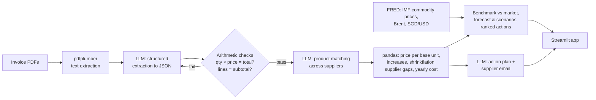

# 🛡️ MarginGuard

**MarginGuard doesn't just tell a small business when supplier costs rise. It shows why, what could come next, and what to do to protect its profit.**

MarginGuard reads a café or restaurant's supplier invoices, tracks the real price of every ingredient over time, and flags increases the owner never noticed, including *shrinkflation* (same price, smaller pack). It then checks each increase against real world-market prices, sketches what could happen next, and ranks practical actions by how much they could save.

**Track:** AI + Business — ForgeHacks 2026

| | |
|---|---|
| 🎥 Demo video | _add YouTube link_ |
| 🌐 Live app | [marginguard-crossdash.streamlit.app](https://marginguard-crossdash.streamlit.app) |


---

## The problem

Small independent restaurants run on razor-thin margins. Before the pandemic, food and labour each took about a third of every sales dollar at a typical independent restaurant, leaving a pre-tax profit of roughly **5%**. Since 2019, wholesale food prices have risen about **35%** ([National Restaurant Association](https://restaurant.org/research-and-media/research/restaurant-economic-insights/analysis-commentary/elevated-costs-continue-to-pressure-restaurant-profitability/)), and 42% of operators said they weren't profitable in 2025 ([Bar & Restaurant, reporting NRA data](https://www.barandrestaurant.com/operations/nra-rising-costs-continue-squeeze-restaurant-profitability)).

Price rises rarely arrive as one big announcement. They show up as a few cents more per line on paper invoices, or as a 10kg bag that quietly becomes 9kg. Owners are too busy to compare every invoice, and even when they spot a rise they can't tell whether it's the market or their supplier, so they don't know whether to push back.

**Who it's for:** owners and managers of small independent cafés, restaurants, bakeries and food stalls who buy from several suppliers and don't have a finance team.

## What it does: Detect → Investigate → Forecast → Act

| Page | Question it answers |
|---|---|
| **Overview** | What changed, what is it costing me, and what should I do first? |
| **Cost Intelligence** | Why did it rise? Is my supplier's increase in line with world market prices? Then *Investigate*: an AI analyst chooses which checks to run and writes cited findings. |
| **Forecast & Scenarios** | Three steps: where might the market go, what if it goes differently, and what would that cost me? |
| **Savings** | Which actions save the most, which cheaper suppliers do I already have, and is a new quote worth switching for? |
| **Data & Checks** | What exactly did the AI read, and how was every number calculated? |

On the 24 sample invoices (3 suppliers, April–September 2026) it finds **$2,104/year** in hidden extra costs (**4.2% of the café's supplier spend**) and tells four different stories:

| Case | Item | What MarginGuard concludes |
|---|---|---|
| **Review needed**: part of the rise can't be checked | Cooking oil | Over the months the market data covers (Apr–Jul) the supplier moved +7.6% against +3.1% for palm and soybean oil: broadly in line. But a further +9.5% landed after the latest published market data, so about $450/yr has no market explanation yet. Ask before absorbing it. |
| Increase **in line** with the market | Plain flour | Bag shrank 10kg → 9kg (+11.1% per kg) while wheat rose about +14%. Hidden, but consistent with the market, so plan for it rather than fight it. |
| **Future cost pressure** | Jasmine rice | Supplier +6%, but Thai rice export prices rose about +22%. A further increase may come; ask for a fixed price. |
| **Cheaper supplier** already available | Eggs | The same eggs cost 9.2% less at another current supplier: $250/year. |

That cooking oil row is the point of the whole design. Comparing a supplier's April–September rise with April–July market data would make any supplier look guilty. MarginGuard compares matched periods, then reports the unverifiable part separately.

Market figures above use FRED data whose latest published month was July 2026 (checked on FRED on 10 Oct 2026). When FRED publishes a newer month, the live app picks it up and recalculates, so they can change.

## How it works



### Why this is more than an AI wrapper

- **AI does four distinct jobs**, each where it's better than rules: reading messy invoices in any layout, matching product names across suppliers, investigating a price rise by choosing which checks to run, and turning findings into plain-English advice and an email.
- **AI output is verified, not trusted.** Every extraction is checked with arithmetic (quantity × unit price = line total; lines add up to the subtotal). If a check fails, the model is told what was wrong and asked to correct itself; anything still wrong is shown as a warning.
- **The AI never does maths.** Every dollar figure, percentage, benchmark, forecast and saving is calculated in deterministic Python, with unit tests.
- **Honest about evidence.** Market data can show that an increase is *in line with* or *larger than* the market. It can't prove *why* a supplier raised a price, so the app separates verified facts, comparisons and unverifiable explanations, and lists the limitations of each comparison.
- **Price per base unit**, not per pack, is what makes shrinkflation visible.
- **Measured accuracy:** on the 24 sample invoices the AI read **99.2% of line-item fields correctly (595/600)**, all 48 invoice dates and numbers were correct, and 23 of 24 invoices were read perfectly (run `python evaluate.py`). The one miss was a garbled product name (`J000asmine Rice`) with every number right; the matching step still grouped it correctly.

### AI Procurement Investigator (agentic)

On **Cost Intelligence**, *Investigate* hands one price rise to an AI analyst that decides what to check next.

- **The model chooses the tools.** After the invoice history (always first), the LLM picks the next step from five tools given the evidence so far: market benchmark, fuel and currency context, supplier options, product comparability and savings calculator. It replies in JSON; code rejects unknown tools, missing arguments and repeats, tells the model why, and stops after 8 steps (and 3 comparability checks).
- **Tools are code, not the model.** They read your invoices, the FRED market series and quotes you entered. Each result becomes numbered evidence (E1, E2, …) labelled *your invoices*, *live verified*, *cached data*, *entered by you*, *demo data*, *calculated* or *unavailable*. Market evidence also carries its source, link, download time, latest observation month, currency, unit and, if it isn't live, why.
- **Product comparability** is the one tool that asks the model a question, inside fixed rules: a product matched across your own invoices is comparable; a different unit (kg vs litre) is *not comparable* whatever the model says; a quote with no specification can't be called comparable. Product text is passed as data, and the model is told never to follow instructions in it.
- **The report cites its evidence, and code checks it:** citations to evidence that doesn't exist are removed; a "verified fact" without valid evidence, or with a figure that isn't in the evidence, is demoted; any other number not in the evidence is flagged; disagreement with the calculated market check is shown as a conflict. Every money figure comes from the tools, never from the model's text.
- **Report:** summary; verified / possible / missing evidence; market context; alternatives with product match and saving; actions with *Save to tracker*; and the full evidence table, step-by-step trace and validation checks.
- **Honest labels:** each run says whether it was a *live AI run* or *replayed from saved AI responses*. News search and online supplier catalogues are **not connected**; the investigator says so and cites nothing from them.

### Market check, forecasts and recommendations

- **Matched-period benchmarks:** each item is classified (edible oils, wheat & flour, rice, sugar, coffee, poultry, dairy, eggs, fresh produce, packaging, energy, logistics). Commodity prices are published about two months late, so the verdict compares the supplier's change and the market's over **exactly the same months**; anything the supplier did after that is reported separately as not yet checkable, never scored against data that doesn't cover it. Within ±5 points = in line. US$ prices are converted to S$. Every benchmark is labelled a **market proxy** (a raw-commodity index), never a direct quote for the product bought. The user can override the classification. Items with no suitable benchmark (dairy, eggs, fresh produce) say so instead of guessing.
- **Context:** Brent crude (a fuel and freight cost signal) and the SGD/USD rate are shown for every food item.
- **Market projection:** the simplest of three methods (last value, exponential smoothing, 12-month straight-line trend) unless another is clearly more accurate in a rolling test on the last 6 months. It is forecast month by month out to the chosen horizon, and the uncertainty range widens with it. On the current data the naive method wins, so the projection is flat — the app says so plainly rather than inventing movement.
- **Your what-ifs, kept separate from the projection:** a **commodity price shock** ("what if palm oil jumps 10%?"), a **US dollar shock** (commodities are priced in US$, so a stronger dollar raises the S$ cost), and a **pass-through** share controlling how much of a market move reaches your invoice. These compound with the projection, never overwrite it, and never touch the historical data.
- **Applicability is explicit.** The commodity and FX shocks only apply to items with a market benchmark. For eggs, dairy and fresh produce the controls are disabled and the app says why, instead of quietly applying a number to a relationship it hasn't modelled.
- **Your price:** clearly labelled *scenarios*, not forecasts (price holds, recent trend continues, supplier catches up on a market rise already seen, market moves and the supplier passes on part of it), each with its basis written out.
- **Baseline vs scenario:** baseline monthly cost, scenario monthly cost and the **cumulative** extra over the chosen horizon. A horizon is not an annualisation: a one-month shock costs one month, and the annual-if-sustained figure is shown separately and labelled as a different question.
- **Profit impact simulator:** turns any scenario into extra monthly and yearly cost and, if you enter revenue and cost of goods sold, the change in gross margin and the selling-price rise needed to offset it.
- **Recommendations:** rules-based (ask for an explanation, challenge an above-market rise, ask for the original pack, switch, plan a menu price review, ask for a fixed price, get a competing quote), ranked by estimated yearly value × confidence in the evidence × ease. It never recommends hedging, and only suggests buying ahead together with storage, spoilage and cash-flow caveats.
- **Three different money figures, never mixed up:**
  - *Savings identified* — only evidence-backed money: a cheaper supplier already on your invoices, a shrunk pack to recover, the part of an increase above the market over the matched period, or a quote you entered. Best option per item, so overlapping options are never added together.
  - *Flagged for review* — increases the market can't explain or doesn't yet cover. Deliberately **excluded** from savings until the supplier answers.
  - *Expected* and *realised* — from the action tracker. Expected is never counted as realised.
- **Supplier comparison workspace:** your current supplier, cheaper prices you already pay elsewhere (verified from your own invoices) and quotes you enter, side by side per kg / litre / item. Shows a landed price (list price plus the delivery you entered, spread over what you buy), minimum order, a "same product / possible substitute" label, source and date. Where delivery is unknown the saving is labelled **gross**, never assumed to be zero, and a quote below its minimum order is not counted as a saving. A web-search shortcut helps you find suppliers; MarginGuard never invents suppliers, listings or prices.
- **Action tracker:** mark any recommendation Saved, Under review, Implemented or Dismissed, and record what you expected against what you actually got. Download and restore it as JSON.

## Data sources

| Data | Source | Live or demo |
|---|---|---|
| Your purchases | Your invoice PDFs | **Demo:** 24 fictional invoices (`sample_invoices/`), clearly labelled in the app |
| Palm oil, soybean oil, wheat, Thai rice, sugar, Arabica coffee, poultry | IMF Primary Commodity Prices, via [FRED](https://fred.stlouisfed.org/) | Live-first (free CSV, no key); see below |
| Brent crude | IMF via FRED | Same |
| SGD per US$ | Federal Reserve G.5, via FRED | Same |

**Market data freshness, live-first:**
1. **Live verified:** every load downloads from FRED, checks the response (CSV layout, at least two years of monthly data, no future dates, no duplicate or non-positive values) and keeps it for 6 hours.
2. **Cached data:** if the download fails or is invalid, the last good download (`market_cache/`) is used, or else the copy shipped with the app (`market_data/`). It keeps its original download time, never "now", and the reason for the fallback is shown. A failed download is retried after 10 minutes, or straight away with **Refresh market data** in the sidebar (limited to once a minute, and FRED rate limits are reported).
3. **Unavailable:** if neither exists, the comparison says so. There is no synthetic market data.

Two dates are kept apart: when the data was **downloaded**, and the **latest month the prices refer to**. Commodity prices are monthly averages published two to three months late, so even live data ends before today (on 10 Oct 2026, FRED's latest palm oil month was July 2026). Data more than 4 months behind is flagged as outdated and its comparisons are marked indicative only. Comparisons always stop at the latest published month; supplier changes after it are never explained with older market data. When newer data arrives, benchmarks are recalculated, and any AI investigation that used the old data is marked out of date. Refresh the shipped copy with `python market.py`.

## Tech stack

- **Python**, **Streamlit** (multi-page UI + hosting on Streamlit Community Cloud), **pandas**, **Altair**
- **"Midnight Slate" dark theme**: a navy/slate/cyan palette defined once in `.streamlit/config.toml` (which styles every native Streamlit widget) and mirrored in a `T` token dict in `app.py` for card surfaces, status pills and chart colours. Every text/background pair meets WCAG AA contrast; colour is reserved for meaning (coral = cost increase, amber = needs review, teal = saving, cyan = interactive) and never used alone to signal status.
- **pdfplumber** for PDF text, **pydantic** for schema validation, **requests** for market data
- **LLM:** any OpenAI-compatible API; we use **Featherless AI** with an open-source model (`Qwen2.5-72B-Instruct`)
- **reportlab** to generate the sample invoices

No new paid services or API keys were needed for the market data.

## Run it locally

```bash
git clone https://github.com/dqnishhh2601/marginguard.git
cd marginguard
python -m venv .venv && source .venv/bin/activate   # Windows: .venv\Scripts\activate
pip install -r requirements.txt
cp .env.example .env        # then put your API key in .env
streamlit run app.py
```

The sample invoices work without an API key because their AI results are cached in `cache/`. Your own invoices need a key. Market data needs internet access; without it the app uses cached data and says why.

Other commands:

```bash
python pipeline.py              # run the invoice pipeline in the terminal on the samples
python evaluate.py              # measure extraction accuracy against the known answers
python tests/test_pipeline.py   # offline test of validation, matching and maths (no API key)
python tests/test_insights.py   # tests for benchmarks, forecasts, scenarios, savings and rankings
python tests/test_investigator.py  # AI investigator with a scripted fake model (no API key)
python tests/test_market.py     # live-first market data, fallbacks, validation and freshness (no network)
python market.py                # refresh the market-data snapshot from FRED
python generate_samples.py      # regenerate the sample invoices
```

## Project structure

```
app.py               Streamlit app: Overview, Cost Intelligence, Forecast & Scenarios, Savings, Data & Checks
pipeline.py          Runs extract → normalize → analyze → recommend
extract.py           PDF → text → LLM → validated JSON (with self-correction)
normalize.py         LLM product matching across suppliers
analyze.py           Price maths, shrinkflation, supplier gaps (no AI)
investigator.py      AI Procurement Investigator: tools, evidence store, bounded orchestrator, citation checks
insights.py          Classification, matched-period benchmarks, forecasts, scenarios, impact, savings, ranked actions (no AI)
market.py            FRED market data: validated live fetch, cached fallbacks, provenance and freshness, period alignment
recommend.py         LLM action plan + supplier email
llm.py               OpenAI-compatible client with on-disk cache
evaluate.py          Extraction accuracy vs ground truth
generate_samples.py  Creates the 24 fictional sample invoices
market_data/         Snapshot of the market series (FRED, retrieved 10 Oct 2026)
sample_invoices/     Sample PDFs, ground_truth.json, PLANTED_CHANGES.md
tests/               Offline tests: pipeline with a fake LLM, 29 for the decision-support maths, 23 for the investigator
```

## What works and what doesn't

**Works**
- Text-based PDF invoices in different layouts and date formats
- Product matching across suppliers, renamed items and changed pack sizes
- Price-increase, shrinkflation and cheaper-supplier detection with yearly cost
- Self-correcting extraction with arithmetic checks
- Matched-period market benchmarks for oils, wheat/flour, rice, sugar, coffee and poultry, with sources, dates and limitations
- Market outlook, supplier price scenarios and a profit impact simulator with gross margin
- Ranked, rules-based recommendations; savings, money flagged for review, expected and realised kept separate
- Supplier comparison per kg / litre / item with landed cost, minimum order and gross-vs-net labelling
- An action tracker for what you did and what it actually saved
- AI investigator that chooses its own checks, cites evidence and has its citations and figures verified in code
- AI action plan and supplier email

**Not yet**
- Photos or scanned paper invoices (would need OCR or a vision model)
- **News and supply-disruption search** for the investigator: not connected, so it can't cite news and says so
- The investigator has been tested with a scripted fake model and a small number of real runs; real model behaviour varies between runs
- **Live online supplier search:** reliable product prices need a paid shopping or search API. Instead the app uses your own invoices, quotes you enter and a web-search shortcut; it never shows unverified prices as real.
- Market benchmarks for dairy, eggs, fresh produce, packaging and electricity (no comparable free series connected); these items say "no benchmark"
- Commodity prices are raw-material prices in US$, not the wholesale product you buy, so comparisons are indicators, not proof
- Connecting directly to accounting software (e.g. Xero) or email inboxes
- Tested on real invoices only in small numbers; the sample data is synthetic
- The AI occasionally garbles a product name (1 of 24 sample invoices); numbers were still correct
- The live demo's own-invoice upload uses our API key, so it may be slow or rate-limited under heavy use; the sample invoices always load from cache
- The action tracker lives in the browser session only (Streamlit Community Cloud has no persistent storage), so it clears on restart. You can download and restore it as JSON; a shared database is the next step
- Commodity prices lag by about two months, so the most recent supplier increases can only be flagged for review, not benchmarked

## Impact

For a café spending about $4,200 a month on supplies, MarginGuard surfaced about $2,100 a year in increases, which matters when typical restaurant profit is around 5% of sales. More importantly, it sorts them: about $490/year of evidence-backed savings to act on now (eggs, flour), about $1,290/year to question before absorbing (cooking oil and items with no benchmark), and the rest to plan for. Each comes with the evidence to take to the supplier.

## Built during ForgeHacks 2026

Built between October 3–10, 2026 by Danish ([@dqnishhh2601](https://github.com/dqnishhh2601)) and _[friend's name]_.

**AI use, honestly:** besides the LLM inside the product, we used Claude (an AI assistant) to help plan the project and to write most of the code, sample data, market-data integration and documentation. We ran it, measured its accuracy (99.2%), fixed the problems we found, deployed it, and reviewed and edited everything, including this write-up, which Claude helped draft. All sample invoices and businesses are fictional; market data is real and sourced.
